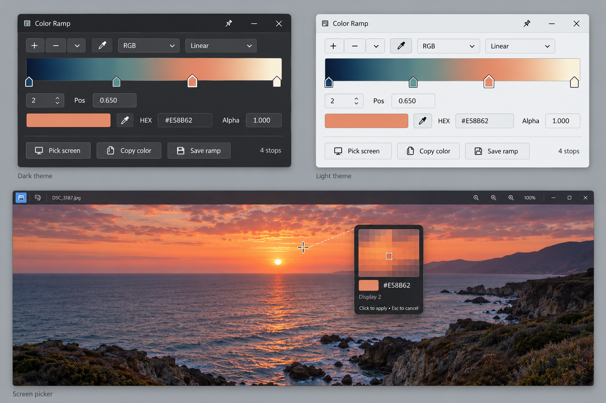

# Color Ramp

A compact standalone Windows color ramp editor inspired by Blender 5.1, with a screen eyedropper that works across connected monitors. Private work in progress; version 0.1.



## Run

Double-click `Launch Color Ramp.cmd` in the local project folder. The portable build is in `dist/ColorRamp.exe`. No administrator rights or Blender installation are needed.

The packaged x64 build includes its .NET runtime. Developer builds need the .NET 8 Windows Desktop runtime (or the .NET 8/9 SDK).

## Using the editor

- Click a stop to select it; drag it to reposition. Use **Pos** for an exact position from 0 to 1.
- **+** inserts a stop between the selected stop and its predecessor (or the next stop when the first is selected). **−** removes the selected stop. A ramp supports 2 to 32 stops.
- Click the color swatch or double-click a stop to open the Windows color dialog. Enter six HEX digits directly or adjust alpha from 0 to 1.
- **Pick screen** hides the editor and shows a magnified pixel preview over a frozen capture of each display. Move between monitors freely. Click or press Enter to apply, Esc or right-click to cancel. Arrow keys move one physical pixel.
- **Copy color** copies the selected stop's six-digit HEX value. **Save ramp** saves the editable settings as `.colorramp.json`.
- The **⋯** menu has Open, flip, distribute, undo/redo, PNG export, and System/Light/Dark theme choices.
- **Pin** keeps the editor above other windows. System theme follows Windows' app theme.

| Shortcut | Action |
|---|---|
| E | Pick screen (outside a text field) |
| Ctrl+S / Ctrl+O | Save / open ramp |
| Ctrl+Z / Ctrl+Y | Undo / redo (HEX text retains native text undo) |
| Ctrl+C | Copy selected color (outside a text field) |
| Delete | Delete stop (outside a text field) |

The last ramp and theme/pin choices are saved in `%LOCALAPPDATA%\ColorRamp`. Screen captures are held only in memory during picking and are discarded when the picker closes. No network access is made by the app.

## Color behavior and current limits

RGB, HSV and HSL modes are supported. RGB interpolation supports Linear, Constant, Ease, Cardinal and B-Spline. HSV/HSL use Linear, Constant or Ease and expose Near/Far/Clockwise/Counterclockwise hue paths. PNG export preserves alpha.

This is an independent app, not an official Blender product or an exact reproduction of Blender's color-management pipeline. Interpolation uses 8-bit display RGB values; Blender may interpolate scene-linear values and apply view transforms. Colors may differ under HDR, wide-gamut or ICC color management. Protected video, secure desktops and some hardware overlays cannot be sampled reliably. Captures freeze the desktop at the time picking begins; restart picking to refresh changing content.

The main interface follows the approved concept. The color-edit dialog is the native Windows dialog in this first version. HEX copying, editable JSON saving and PNG export are implemented; a saved-ramp library and Blender import/export are not yet included.

## Build and verify

```powershell
dotnet build -c Release
dotnet publish -c Release -r win-x64 --self-contained true -p:PublishSingleFile=true -p:IncludeNativeLibrariesForSelfExtract=true -o dist
```

For the built-in verification suite:

```powershell
Start-Process .\bin\Release\net8.0-windows\ColorRamp.exe -ArgumentList '--self-test artifacts/self-test.txt' -Wait
Get-Content artifacts/self-test.txt
```

The checks cover interpolation/alpha, hue paths, duplicate stops, invalid data, independent undo snapshots, file round trips, layout, and a capture of each attached monitor. Captures are discarded, not saved. Live manual verification should include dragging stops and picking across displays with differing scaling settings.

Sources: [Blender 5.1 Color Ramp widget](https://docs.blender.org/manual/en/5.1/interface/controls/templates/color_ramp.html), [Windows screen capture](https://learn.microsoft.com/en-us/dotnet/api/system.drawing.graphics.copyfromscreen).

## AI disclaimer

This project was coded with AI assistance using OpenAI Codex.

